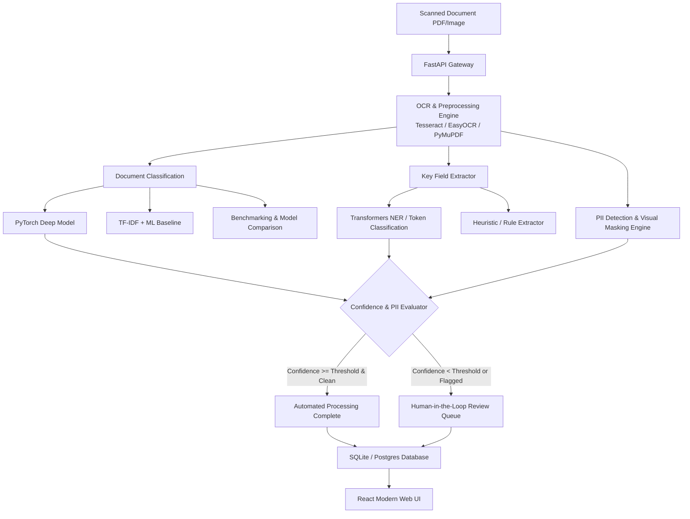

# Enterprise Document Intelligence API & Platform

A comprehensive, production-grade Document Intelligence platform built with **PyTorch**, **Hugging Face Transformers**, **Multi-Backend OCR (Tesseract / EasyOCR)**, **FastAPI**, **Docker**, **AWS**, and an interactive **React + Tailwind CSS** frontend with Human-in-the-Loop (HITL) manual review and real-time PII redaction.

---

## 🚀 Key Highlights & Architecture

- 🔍 **Multi-Backend OCR**: Reads scanned documents (PDF, PNG, JPG, TIFF) with image enhancement (contrast, Otsu thresholding, sharpening) and extracts normalized word bounding boxes `[ymin, xmin, ymax, xmax]`.
- 🧠 **PyTorch Deep Neural Classifier**: Deep neural embedding network classified against a **TF-IDF + Logistic Regression Baseline** across 7 document classes (`INVOICE`, `RECEIPT`, `EMPLOYMENT_CONTRACT`, `IDENTITY_DOCUMENT`, `RESUME`, `BANK_STATEMENT`, `TAX_FORM`).
- ⚡ **Model Benchmarking**: Live evaluation suite reporting Accuracy, Macro F1, Latency (ms), Per-class F1, and multi-class Confusion Matrices.
- 🏷️ **Transformers Key Field Extractor**: Hugging Face NER + regex hybrid token classification extracting structured metadata (Invoice #, Dates, Total Amount, Tax, Vendor, Employee, Salary, Aadhaar/ID).
- 🛡️ **PII Detection & Visual Redaction**: Detects high-risk sensitive identifiers (SSN, Aadhaar UID, PAN, Credit Cards, Emails, Phones) and automatically creates solid black visual redaction overlays directly on the document image canvas.
- 👨‍💻 **Human-in-the-Loop (HITL) Review Queue**: Automated confidence triage ($< 85\%$ classification or $< 80\%$ field confidence or sensitive PII) routing documents to reviewer workbench for approval/rejection and audit trails.
- 🎨 **Modern React & Tailwind Frontend**: Split-screen workbench with interactive document canvas, zoom controls, OCR bounding box hover inspectors, and live PII sandbox.
- 🐳 **Docker & AWS Deployment**: Multi-stage Dockerfiles, Docker Compose, Terraform (ECS Fargate, S3, ALB), and CloudFormation stacks.



---

## 🛠️ Project Structure

```
.
├── backend/
│   ├── app/
│   │   ├── main.py                  # FastAPI application entrypoint
│   │   ├── config.py                # Settings, thresholds, classes
│   │   ├── database.py              # SQLite / SQLAlchemy engine & session
│   │   ├── models/
│   │   │   ├── db_models.py         # SQLAlchemy database models
│   │   │   └── schemas.py           # Pydantic request/response schemas
│   │   ├── services/
│   │   │   ├── ocr_service.py       # Tesseract OCR & bounding box extraction
│   │   │   ├── classifier.py        # PyTorch Deep Neural Network & TF-IDF Baseline
│   │   │   ├── extractor.py         # Hugging Face Transformer NER & Rule Extractor
│   │   │   ├── pii_detector.py      # PII detection & image redaction engine
│   │   │   ├── benchmark_service.py # Model evaluation & confusion matrix generator
│   │   │   ├── review_queue.py      # HITL triage & correction management
│   │   │   └── sample_docs_generator.py # Synthetic sample document image generator
│   │   └── api/
│   │       ├── routes_documents.py  # Upload, process, preset, list, image endpoints
│   │       ├── routes_review.py     # HITL manual review queue & decision submissions
│   │       ├── routes_benchmark.py  # Live model benchmarking & historical metrics
│   │       └── routes_pii.py        # PII inspection and text sanitization
│   ├── tests/                       # Complete pytest unit & integration test suite
│   ├── requirements.txt
│   └── Dockerfile
│
├── frontend/
│   ├── src/
│   │   ├── App.jsx                  # Main application with multi-tab workflow
│   │   ├── components/
│   │   │   ├── Navbar.jsx           # Top navigation & system readiness indicator
│   │   │   ├── DocumentUpload.jsx   # Drag & drop upload + 1-click sample presets
│   │   │   ├── DocumentViewer.jsx   # Interactive canvas with OCR boxes & redaction toggle
│   │   │   ├── ExtractionResults.jsx# Extracted fields, confidence badges & inline edit
│   │   │   ├── ModelComparison.jsx  # PyTorch vs TF-IDF benchmark, F1 & Confusion Matrix
│   │   │   ├── ReviewQueue.jsx      # HITL review queue workbench & audit actions
│   │   │   ├── PIIDetectionCard.jsx # PII entity badges & interactive redaction sandbox
│   │   │   └── AnalyticsDashboard.jsx # Pipeline KPIs and document audit trail
│   │   └── services/
│   │       └── api.js               # Axios API client
│   ├── package.json
│   ├── vite.config.js
│   └── Dockerfile
│
├── deploy/
│   ├── docker-compose.yml           # Full-stack Docker orchestration
│   ├── nginx.conf                   # Nginx reverse proxy configuration
│   └── aws/
│       ├── terraform/               # Terraform AWS ECS Fargate + S3 + ALB
│       ├── cloudformation.yaml      # AWS CloudFormation stack template
│       └── deploy_aws.sh            # Automated ECR push and deployment script
└── sample_documents/                # Pre-generated sample documents (Invoices, IDs, etc.)
```

---

## ⚡ Quickstart Guide

### 1. Backend Setup

```bash
cd backend
pip install -r requirements.txt
python -m uvicorn app.main:app --host 0.0.0.0 --port 8000 --reload
```
API Documentation (Swagger UI) is available at `http://localhost:8000/docs`.

### 2. Frontend Setup

```bash
cd frontend
npm install
npm run dev
```
Open `http://localhost:5173` in your browser.

---

## 🐳 Docker Deployment

To launch the entire stack (Backend + Frontend + Nginx):

```bash
docker-compose -f deploy/docker-compose.yml up --build -d
```
Access the application at `http://localhost:3000` or `http://localhost`.

---

## ☁️ AWS Cloud Deployment

### Method A: Terraform (ECS Fargate + S3 + ALB)

```bash
cd deploy/aws/terraform
terraform init
terraform apply
```

### Method B: Automated Bash Script

```bash
chmod +x deploy/aws/deploy_aws.sh
./deploy/aws/deploy_aws.sh
```

---

## 🧪 Running Tests

```bash
pytest backend/tests -v
```

---

## 📜 REST API Reference

| Method | Endpoint | Description |
|---|---|---|
| `POST` | `/api/documents/process` | Upload and process scanned document or PDF |
| `POST` | `/api/documents/process-preset/{name}` | Process pre-built preset (`INVOICE`, `RECEIPT`, `CONTRACT`, `ID_CARD`) |
| `GET` | `/api/documents` | List processed documents with filtering & pagination |
| `GET` | `/api/documents/{id}` | Get document metadata, extracted entities, and bounding boxes |
| `GET` | `/api/documents/{id}/image` | Get rendered preview image |
| `GET` | `/api/documents/{id}/redacted-image` | Get visually redacted document image |
| `GET` | `/api/review-queue` | List documents requiring HITL manual review |
| `POST` | `/api/review-queue/{id}/submit` | Submit review approval/rejection and field corrections |
| `POST` | `/api/benchmark/run` | Run real-time PyTorch vs TF-IDF benchmark |
| `POST` | `/api/pii/redact` | Scan and sanitize raw text for sensitive PII |
| `GET` | `/api/stats` | Pipeline processing statistics and STP rate |

---

## Results

### Document classification benchmark (7 classes)

Evaluated with the built-in benchmark (`POST /api/benchmark/run`) on a held-out set of **16 short documents**
(2-3 per class) against a training corpus of **42 documents**. Four runs were recorded in `doc_intel.db`
(each app start retrains both models):

| Run | PyTorch accuracy | PyTorch macro-F1 | TF-IDF + LR accuracy | TF-IDF + LR macro-F1 |
|---|---|---|---|---|
| 1 | 37.5% | 0.374 | 100% | 1.000 |
| 2 | 62.5% | 0.610 | 100% | 1.000 |
| 3 | 75.0% | 0.739 | 100% | 1.000 |
| 4 | 43.8% | 0.449 | 100% | 1.000 |
| **Mean** | **54.7%** | **0.543** | **100%** | **1.000** |

Average inference latency per document (classification only, excluding OCR): PyTorch 1.2-2.5 ms, TF-IDF + LR 1.8-3.5 ms.

**Reading these numbers honestly**
- The TF-IDF + Logistic Regression baseline outperformed the PyTorch model in all four runs; PyTorch results varied widely between runs (37.5%-75.0%), which points to instability on a 42-document training set.
- The 16-document test set is very small (one document = 6.25 points of accuracy), and one test document (`INV-2024-5501`) is a near-duplicate of a training document. A leave-one-out check of the same TF-IDF + LR setup on the 42 training documents gives **88.1% accuracy (37/42), macro-F1 0.877**, a more conservative estimate of the baseline.
- Documents are short hand-written text samples, not a large real-world scanned corpus; these results do not predict accuracy on real scans.

### Tests
13 pytest tests across 5 files (API, classifier, extractor, OCR, PII). <!-- add the pass count from your own `pytest -v` run -->

### Planned improvements
- Larger, de-duplicated labelled dataset with a proper train/test split.
- Fixed random seeds and averaged results across several seeds, reported as mean +/- std.
- Fine-tuned transformer classifier compared against the baseline.